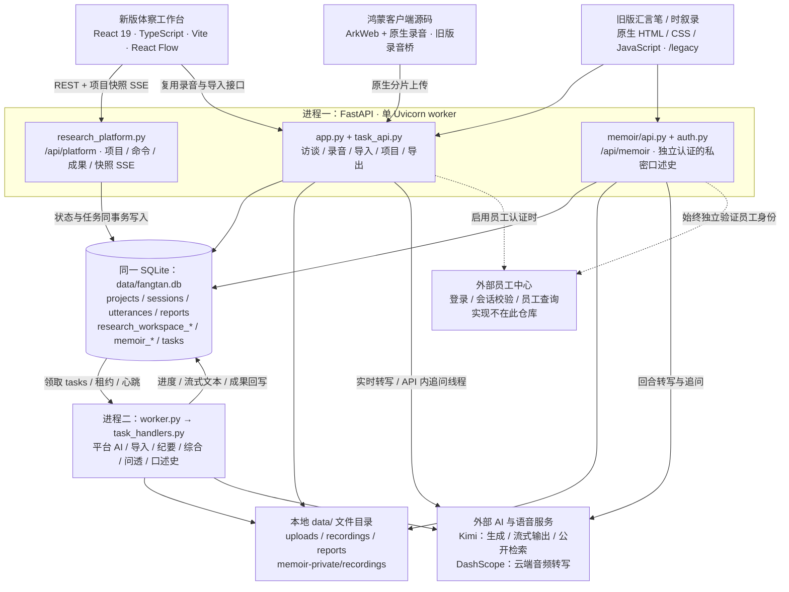
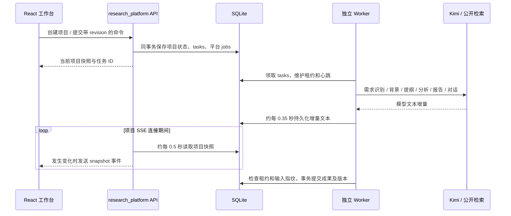
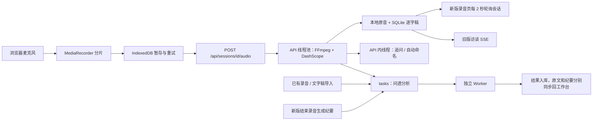

# 当前项目架构说明

> 本文与配套图片保留首次下载时的架构快照。后续新增的对谈及口述史 Agent 架构、记忆与跨次章节实现，请阅读 [最新实现说明](../specs/MEMOIR_AGENT.md)。

依据 2026-10-17 下载的代码快照梳理。本文描述当前实现，不把历史规划当作已交付功能。

| 项目 | 内容 |
| --- | --- |
| 来源 | [2105774795-svg/fangtan-agentic-system](https://github.com/2105774795-svg/fangtan-agentic-system) |
| 本地目录 | `C:\fangtan.agent` |
| 分支 | `main` |
| 源码提交 | `8abfa9f50ed44cd9de86af334285ae3bd756bc4f` |
| 下载内容 | 完整 Git 克隆，包含源码、提交历史、测试、规范、鸿蒙工程及部署模板；克隆时有 166 个被跟踪文件 |
| 本次操作 | 下载与静态代码核查，新增本说明和架构图；未安装项目依赖、配置密钥或启动服务 |

核心形态是**模块化单体 API + 独立后台任务进程 + SQLite + 本地文件存储**。客户端有新版 React 工作台、旧版网页和可选鸿蒙工程。AI 工作流由固定阶段状态机与模型适配代码实现。

## 1. 总体架构图

- [可直接查看的 PNG 架构图](architecture-current.png)
- [可缩放的 SVG 架构图](architecture-current.svg)
- [可编辑的 Mermaid 图源](architecture-current.mmd)



图中的 `tasks` 是同一 SQLite 内的表。Worker 不监听 HTTP 端口，通过数据库领取任务并回写结果；浏览器通过 API 读取结果。FFmpeg 在本机处理音频，Kimi、DashScope 和员工中心通过 HTTP 访问。

## 2. 代码目录与模块职责

```text
C:\fangtan.agent\
├─ frontend/                       新版 React 工作台源码
│  ├─ src/App.tsx                  首页、项目状态、REST 与项目 SSE
│  ├─ src/Workspace.tsx            工作台布局、阶段、局部编辑状态
│  ├─ src/ResearchMap.tsx          React Flow 画布、节点和坐标保存
│  ├─ src/AssistantPanel.tsx       对话、确认选项和阶段推进
│  ├─ src/ArtifactEditor.tsx       成果编辑、版本和导出
│  ├─ src/MarkdownContent.tsx      Markdown 展示、原文引用跳转
│  ├─ src/InterviewRecorder.tsx    浏览器录音、上传和会话轮询
│  ├─ src/MaterialCapture.tsx      粘贴和导入文字材料
│  ├─ src/recordingOutbox.ts       复用旧版 IndexedDB 分片队列
│  └─ vite.config.ts              开发代理与生产构建输出
├─ backend/
│  ├─ app.py                      FastAPI 入口、鉴权、录音、访谈、导出
│  ├─ research_platform.py        新工作台 API、状态机、成果、布局、AI 任务提交
│  ├─ platform_ai.py              新平台 Kimi 流式生成、引用和文档工具
│  ├─ store.py                    SQLite 连接、旧业务表和兼容迁移
│  ├─ job_queue.py                SQLite 持久队列、领取、租约、取消和重试
│  ├─ worker.py                   独立后台任务执行进程
│  ├─ task_handlers.py            后台任务类型与处理器注册
│  ├─ task_api.py                 通用任务状态及控制接口
│  ├─ kimi.py / place_research.py 模型调用、地点与公开资料检索
│  ├─ asr_dashscope.py            云端音频转写适配
│  ├─ coverage_ai.py              提纲问题是否“问透”的原文证据分析
│  ├─ importer.py / services/     材料解析、提纲生成和原文装配等服务
│  ├─ project_records.py          多场访谈综合记录
│  ├─ project_bundle.py           项目 ZIP 打包
│  ├─ word_export.py             Word 文档导出
│  ├─ employee_auth.py            通用员工身份与外部员工中心适配
│  ├─ memoir/                     旧时叙录：独立认证、私密业务、后台处理
│  ├─ static/index.html + assets/ 旧版网页与公共录音支持脚本
│  ├─ static/platform/            新版前端构建产物，下载源码时尚不存在
│  └─ tests/                      Python 与 Node/Playwright 回归测试
├─ harmonyos/                      鸿蒙 ArkTS 原生录音工程源码
├─ scripts/                        前端回归、隔离夹具和显式云端联调脚本
├─ examples/deployment/            Linux API/Worker 双进程部署模板
├─ specs/                          产品、技术、接口和历史演进规范
└─ data/                           运行后生成，源码仓库不包含业务资料
```

新版使用 React Hooks 管理界面状态，项目真值保存在后端快照中；业务 `revision` 与画布布局 `version` 独立，避免拖动节点使 AI 输入失效。音频分片在浏览器 IndexedDB 中暂存，服务端确认后再清理。

依据：`frontend/src/App.tsx:20`、`:78`、`:100`、`:114`，`frontend/src/types.ts:20`，`frontend/src/recordingOutbox.ts:7`，`backend/research_platform.py:58`、`:110`、`:177`。

## 3. 两条关键处理链路

### 新工作台 AI 任务



固定阶段为：**需求确认 → 背景与计划 → 提纲 → 现场采集 → 综合分析 → 成果归档**，企业访谈与口述史使用各自的阶段名称。用户确认推动流程；聊天支持 `create_document` 工具，在已进入的模块新增文档。修改原始材料会将下游成果标记过期。

依据：`backend/research_platform.py:27`、`:159`、`:198`、`:366`、`:620`，`backend/platform_ai.py:35`、`:96`、`:169`。通用队列支持重试；当前平台 AI 提交设置 `max_attempts=1`，失败后的用户重试会新建任务，不能把通用队列重试能力理解为平台 AI 会自动无限重试。

### 现场录音与已有材料导入



实时上传分片随 HTTP 请求处理，转写不经过持久队列。导入、问透分析和新版结束录音后的纪要进入 Worker。新版录音页的文字更新采用轮询；项目工作台采用快照 SSE；旧版访谈另有进程内事件总线 SSE。

依据：`frontend/src/InterviewRecorder.tsx:67`、`:87`、`:141`，`backend/app.py:790`、`:969`、`:1003`、`:1126`、`:1175`、`:1332`，`backend/task_handlers.py:405`。

## 4. 数据与外部依赖

| 分组 | 当前实现 |
| --- | --- |
| 数据库 | 默认 `data/fangtan.db`；通过标准库 `sqlite3` 访问，业务和任务共用一个文件 |
| 访谈与项目 | `projects`、`sessions`、`utterances`、`reports`、`project_records`、`audio_receipts` 等 |
| 新版工作台 | `research_workspace_runs` 保存 JSON 快照与 revision；`research_workspace_jobs` 保存任务类型、输入指纹、输出；`research_workspace_layouts` 保存画布位置与独立版本 |
| 后台队列 | `tasks` 保存任务状态、payload、租约、心跳、进度及重试次数 |
| 私密口述史 | `memoir_profiles`、`memoir_sessions`、`memoir_turns`、`memoir_events`、`memoir_chapters` 和独立认证表；仍在同一 SQLite 中 |
| 本地文件 | `data/uploads/`、`data/recordings/`、`data/reports/`；私密口述史原音在 `data/memoir-private/recordings/` |
| 模型与搜索 | `KIMI_API_KEY` / `KIMI_BASE_URL` / `KIMI_MODEL`；通过 Kimi 生成内容，公开检索适配 `tools/search_pro` |
| 转写与音频 | `DASHSCOPE_API_KEY`；FFmpeg 本地转换。依据公网 HTTPS 配置选择 filetrans 或 Base64 同步路径 |
| 员工身份 | `AUTH_API_URL` 对接外部员工中心；本仓库只含适配代码 |

依据：`backend/config.py:22`、`backend/store.py:11`、`:168`、`backend/job_queue.py:32`、`backend/research_platform.py:58`、`backend/memoir/store.py:21`、`backend/asr_dashscope.py:179`。

## 5. 当前实现中需要分清的边界

1. **新版首页需要构建。** `/` 在 `backend/static/platform/index.html` 存在时返回新版；否则回退旧版。`/legacy` 始终返回旧版。下载快照未包含新版构建产物。构建步骤见 [新版说明](../frontend/README.md)；本次没有执行构建或启动。
2. **新版“口述史”与旧“时叙录”是两套业务。** 前者是 `/api/platform` 下 `scenario=memoir`，复用工作台与普通访谈数据；后者是 `/api/memoir`，独立 Cookie、所有权校验、业务表和文件命名空间。私密域仍与其他模块共用数据库。
3. **新版本地模式与员工认证尚未统一。** 虽然新版说明称“免登录”，代码中的全局中间件仍覆盖 `/api/platform`，且 `FANGTAN_AUTH_ENABLED` 默认 `true`。平台项目和新建访谈固定使用本地所有者 `-1`；认证开启时，旧录音接口按员工 ID 校验，会出现所有权不匹配。当前本地工作台链路依赖显式关闭通用认证，独立时叙录仍需要员工认证。平台路由自身也未实现逐员工项目过滤，不能当作已完成的多用户权限架构。
4. **API 需要保持单 Uvicorn worker。** 实时录音锁、访谈事件总线和部分后台线程仍为进程内状态。API 与 Worker 必须使用同一配置和数据目录；增加 API 实例前需要改造协调与存储。
5. **鸿蒙是可选源码工程。** 原生后台采音桥只接旧版录音脚本；新版录音组件目前使用浏览器 MediaRecorder。工程尚未完成 HAP 编译、签名与真机验收，手机扫码接续也未接入。
6. **AI 与材料有明确边界。** 新建工作台默认真实 AI 模式，历史 demo 另有标识。原始材料单份最多 20,000 字、项目总量 50,000 字；引用标记校验不能替代人工核实。分析后的原文、纪要和报告分别保存。

依据：`backend/app.py:112`、`:145`、`:417`，`backend/employee_auth.py:66`，`backend/config.py:21`，`backend/research_platform.py:25`、`:513`，`frontend/src/InterviewRecorder.tsx:103`，`backend/static/assets/recording.js:3`，以及 [鸿蒙说明](../harmonyos/README.md)。

## 6. 文档时效与核查范围

根 [README](../README.md) 的开头已增加新版说明；后续“原生 HTML、无前端构建”主要描述旧版。`specs/ARCHITECTURE.md` 主要覆盖旧访谈与私密口述史；`specs/PLATFORM_PHASE1.md` 中“录音、导入、真实模型未接入”等内容是历史阶段记录。理解当前新版时，应结合 [frontend/README.md](../frontend/README.md) 和本文所列代码入口。

本次核查包括：完整 Git 克隆与对象连通性检查、页面入口与构建配置、前端请求路径、后端路由/中间件、队列处理器、数据库建表及外部服务适配。没有进行运行时联调、云端调用或现有测试套件执行；架构图表示代码关系，不表示本机服务已运行。
