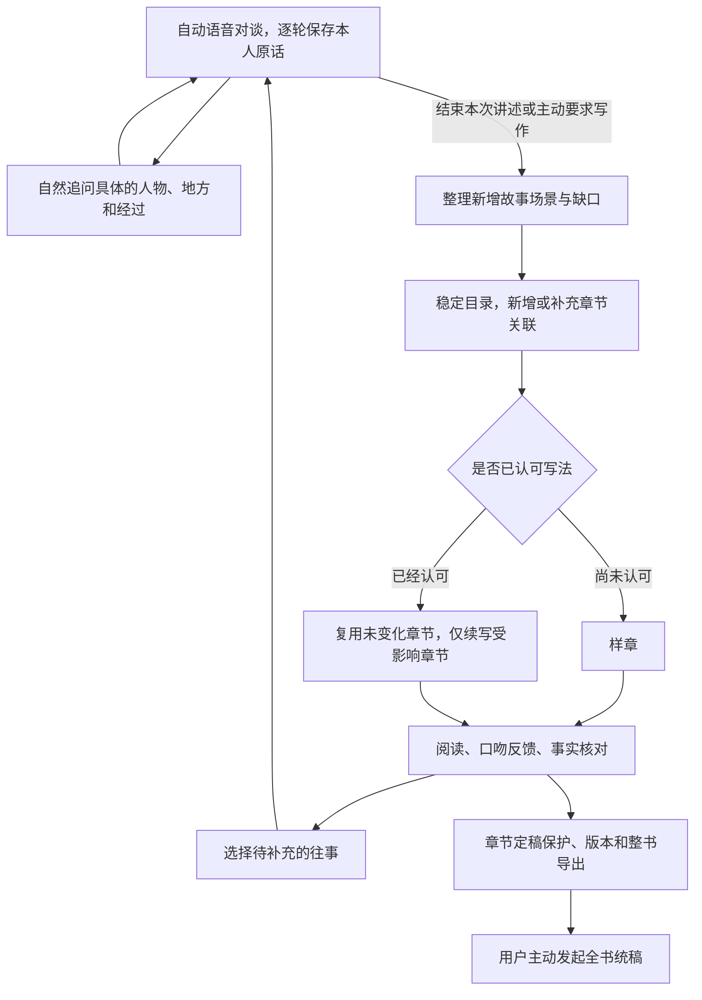

# 通过对话慢慢写成一本人生自传

当前口述史的最终产出是可连贯阅读、持续补写的第一人称人生传记。人物线索、原始录音和逐场整理稿是写作资料，主入口改为「我的传记」。此前生成的书稿不删除，人工改稿与已审阅版本升级时需明确采用新的修订方案。

## 写作约定

默认参考沈从文《从文自传》的朴素回忆体：以人生时间为骨架，从人物、地方和具体经历展开，情感节制，保留传主自己的措辞和性情。参考写法，不复制原作句段、不把传主写成沈从文、不移植湘西背景。

没有讲过的天气、对白、心理、年代、人物关系和因果不得补造。文风意见只控制表达；事实异议形成后续采访问题，不充当经历来源。本人原话中的不确定、异议和更正继续保留。

可设置暂定书名与口吻偏好，章节级反馈包括「这里写得不像我」「这件事有出入」「这一段再多写一点」。先写一章样稿，用户认可写法后再逐步展开全书，不按字数注水。

## 对话与写作循环



对谈时提供相关书稿缺口和用户选定的往事，优先承接正在讲的事情，每次仍只问一个问题。明确跳过或标记已讲清的问题不列入开放缺口，可随时重新选择。文学写作在后台进行，不把长书稿拿来替代即时对谈。

## 实现

| 模块 | 职责 |
|---|---|
| `backend/memoir_editor/biography.py` | 文风约定、场景/目录/写作/统稿提示词、设置与采访缺口 |
| `backend/memoir_editor/chapters.py` | 场景增量提取、稳定目录、局部正文指纹、检查点、原话及语义检查、章节修订保护 |
| `backend/memoir_editor/models.py` | 写作模式与设置 API 输入校验 |
| `backend/agents/context.py`、`memoir_agent.py` | 写作目的、相关缺口、用户选题与已跳过问题进入采访上下文 |
| `frontend/src/MemoirExperience.tsx` | 我的传记 / 待补充的往事 / 资料与核对 |
| `frontend/src/MemoirNotebook.tsx` | 连贯阅读、写作约定、反馈、修订对照、定稿和两种导出 |

`memoir_book_settings` 是新增表，由现有 `conversation_engine.init()` 创建，按项目保存设置及其修订号。场景、目录、正文指纹和材料指纹放在现有书稿文档内，模型阶段结果继续保存在 `memoir_book_steps`。删除项目时新增设置随派生资料一起清理，旧私密时叙录的数据和权限不合并。

### 场景与目录

场景保存稳定编号、概述、人物、地点、原话时间、引用、来源编号及待追问问题。只提取新增或已变化原话，旧场景可关联后续补充；每批检查引用和语义。操作性话语可以延后处理，不能强行写成人生事件。

目录按每批最多20个新增场景逐步扩展，不再限制12章或强制一轮原话只属于一章。同一场景可以支持不同章节，各章有叙事侧重。已有章节编号稳定；后来补讲的早年经历可插入已有章节之前。当前目录的工程处理预算是100章，超预算保留已有书稿并明确失败。

### 续写、修订与统稿

每章正文指纹由关联原话、相关记忆状态、文风与本章意见组成。未变化的章节直接复用；模型写作仍按原话分块，并提供同章前文、前一章末尾和叙事侧重辅助承接。书名变化不要求重写所有章节正文。

人工修改、章节定稿和整书审阅都受到保护。新材料或统稿导致受保护章节变化时，保留当前正文并提供 `pending_revision`；其他未受保护章节可以继续更新。用户可以逐章对照采用，也可明确采用整份修订方案。所有写入检查修订号、任务租约、项目存在及资料指纹，迟到任务不能覆盖新编辑。

全书统稿由用户发起，对未保护正文提出修订，对保护文字提供方案；事实检查仍逐块执行。连续性检查的窗口覆盖全部正文、相邻窗口重叠一个段落，另提供全书目录及首尾提示。报告人物称呼、时间、重复和衔接问题，存在问题时不标为统稿通过。模型检查不是独立事实核验，也不能保证文学质量，仍需阅读修订。

正文默认隐藏引用，可切换「核对与编辑」查看依据。Markdown 导出分为纯正文阅读版和附原话的审校版。

## API 增量

路径均位于 `/api/platform/projects/{pid}`，沿用项目访问权限。

- `POST /conversation-book`：`mode=sample|continue|polish`，默认 continue；尚未认可写法时只写样章，统稿需先认可写法。
- `POST /conversation-book/settings`：带设置 `revision`，动作含 settings、approve_style、feedback、focus_gap、skip_gap、resolve_gap。
- `GET /conversation-book`：增加 settings、gaps；书稿含 format、title、stage、outline、scenes、editorial_notes 和章节保护信息。
- `GET /conversation-archive`：增加 book_settings、book_gaps。
- `POST /conversation-book/review`：继续兼容 edit/review/adopt，新增 lock_chapter/unlock_chapter/adopt_chapter；新增动作优先传稳定 chapter_id。

## 离线验证与生效

使用独立数据目录、清空云密钥后运行后端测试，操作见 `CONTRIBUTING.md`。`test_biography.py` 覆盖样章认可、局部续写、场景合并、多章关联、目录插入、长原话、人工和定稿保护、旧稿迁移、反馈与缺口、全书审校及迟到结果。

```powershell
npm run build:platform
node scripts/test-memoir-agent-ui.cjs
npm run test:conversation:auto
```

浏览器测试全部拦截网络，使用合成人物、合成 API 和合成声音，不启动项目服务。传记界面截图和两种导出位于 `data/qa/biography/`。真实模型的传记文风与追问质量需再用实际体验判断，离线夹具不证明文风已经达到参考作品的水准。

本次包含后端逻辑和新增表。当前运行的 API、通用 Worker、即时对谈 Worker 都需在用户明确允许后重新加载，之后刷新浏览器才能体验完整新版；仅刷新页面不能加载后端 Python 改动。不得为了生效自行启停服务。
