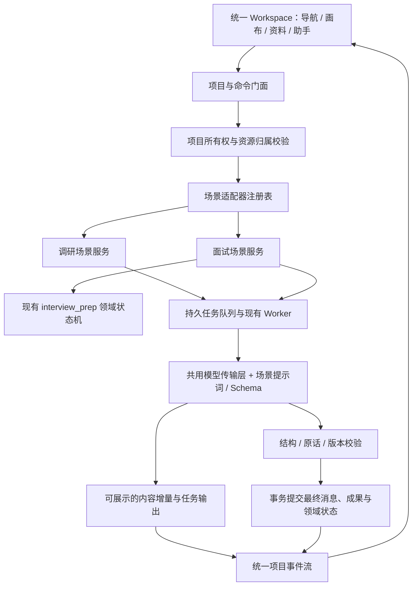

# 面试与调研工作台整合技术方案

日期：2026-10-17。状态：已完成代码实施和隔离验证，运行发布需另行授权；下文保留设计目标，实际交付边界见末节。

## 1. 目标与现状

将面试准备作为现有 Research Studio 的一种项目场景，沿用项目选择器、左侧导航、中央流程画布和右侧助手。面试中的准备、资料、练习、复盘、重练与导出都在同一项目内完成。聊天恢复真实模型流式输出，已保存的练习和原音证据继续有效。

当前代码中的隔离点：

- `frontend/src/App.tsx` 的 `prepId`、`/?prep=`、独立创建分支直接渲染 `InterviewPreparation`，绕过 `Workspace`；列表也是临时合并两套接口的结果。
- `InterviewPreparation.tsx` 同时承担独立页面外壳、准备表单、资料、练习、复盘与历史记录。`PreparationForm` 的气泡主要来自条件分支中的固定文案，没有持久的自由对话消息流。
- `backend/interview_prep` 已共用 SQLite 和 tasks 队列，但拥有独立的项目身份、配置、版本与 SSE 快照。模型通过 `kimi._chat(..., json_mode=True)` 返回完整结构，校验完成后才保存。
- `research_platform.py` 已有任务流式缓冲、约 350ms 持久化刷新和约 500ms SSE 快照；`AssistantPanel` 能用 `project.job.output` 渲染生成中的 Markdown。`platform_ai.stream` 已读取模型真实内容增量。

因此不能只把独立页面放进原工作台，也不能只给完整答案加打字动画。需要打通项目模型、场景能力、消息与任务协议。

## 2. 整合后的界面与流程

保留截图中的顶部项目选择器、左侧导航、中央画布、右侧“对话 / 资料 / 任务 / 见解”布局。场景只决定文案、节点内容、工具和专用录音面板。

| 区域 | 面试场景的内容 | 复用方式 |
| --- | --- | --- |
| 项目与历史 | 面试与市场、企业项目统一列出，带场景标签 | 共用项目身份、列表和打开入口 |
| 流程画布 | 目标确认 → 背景与材料 → 问题与策略 → 模拟练习 → 复盘改进 → 成果归档 | 复用 ResearchMap、拖拽、缩放和布局保存 |
| 左侧采集入口 | 文案切换为“模拟练习”，管理多场练习和逐题作答 | 保留面试专用的作答与转写确认组件 |
| 项目资料 | 简历、岗位描述、论文、历史问题、准备计划、回答和复盘 | 共用资料浏览与成果编辑，标记资料类型及版本 |
| 右侧对话 | 补充目标、讨论岗位、分析历史问题、解释策略，支持真实流式输出 | 复用助手、Markdown、停止生成与重试 |
| 右侧任务 | 生成计划、题目分析、分析回答、生成复盘的进度和失败状态 | 统一任务视图，保留不同任务作用域 |
| 右侧见解 | 需补充的经历依据、回答薄弱点、可追问的线索、重练建议 | 来自已校验结果，可定位原话或回答 |

典型操作：用户输入面试目标，进入同一工作台；助手流式承接并提出有必要的补充问题。上传简历后，资料出现在项目资料和画布对应节点。确认计划后进入中央模拟练习区，右侧助手仍保留。回答录音上传、转写校对与确认沿用现有状态机；确认后产生下一题或辅导反馈。练习结束生成复盘，选择薄弱项重练，与原练习形成关联。

自由聊天、模型生成和录音练习分别显示状态。准备材料可以跳过；画布节点是工作状态与成果入口，不强迫用户填写完整表单。

录音练习期间，输入框明确显示“本题作答”或“场外讨论”。讨论不自动记作答案、不推进下一题；草稿也不冒充已确认回答。切换模式前需保存或处理当前录音。

## 3. 架构与职责



统一应用层体验与资源身份；领域规则继续封装。面试的逐题状态、反问、转写确认、引用校验、模拟模式隐藏反馈、原音播放和同题对比继续使用现有实现。调研的实地采集和报告规则继续由原服务负责。

### 前端

- 从 `Workspace.tsx` 提取共享外壳 `WorkspaceShell`，保留现有页面风格和移动端布局。
- 增加轻量的 `sceneRegistry`：配置场景名称、六阶段、节点摘要、资料分类、助手工具及采集视图。第一版保持六阶段兼容，同时为节点引入稳定的 `step_key`，避免阶段排序变化导致资料错挂。
- 从 `InterviewPreparation.tsx` 拆出 `InterviewSetup`、`InterviewMaterials`、`InterviewQuestionBank`、`InterviewPractice`、`InterviewReview`、`InterviewHistory`。这些组件由工作台视图挂载，不再携带独立导航和项目外壳。
- 抽出共享 `useProjectEvents`、`useProjectCommands`、消息渲染和任务状态组件；原有场景继续兼容。
- 所有正常项目用 `/?project=<id>` 打开；旧 `/?prep=<id>` 做鉴权后的兼容跳转。录音离页保护、未保存编辑提醒、刷新恢复继续保留。

### 后端

- 在统一项目 API 内按场景分发创建、命令、资料和读取；面试命令通过适配器调用现有 domain，避免两套状态机分别推进。
- 补齐后端场景配置 `interview`。原调研 `brief/background/outline/...` 动作不直接套用到面试；场景适配器返回合法动作和当前状态。
- 共用模型传输、超时、取消、错误分类与恢复基础设施；提示词、Schema、上下文装配和反馈证据校验按场景分开。
- 现有通用 Worker 继续处理长任务。即时面试聊天可接入当前低延迟对谈处理通道，通过显式的任务类型白名单路由；不默认增加新服务或引入 Redis。
- 普通任务、自由聊天与每场练习分别确定作用域和互斥条件，不继续用单个 `project.job_id` 阻塞整个项目。

## 4. 项目、资料与状态统一

以现有 `projects.id` 为统一身份和权限根，工作台保存项目摘要、消息、流程布局与成果索引；逐场练习和作答细节以面试领域表为唯一权威。

第一阶段为 `interview_preparations` 增加唯一的 `workspace_project_id` 关联。新项目在一个事务内创建统一 projects、workspace run 和面试扩展记录。旧项目优先复用原 `ip_...` 编号作为统一编号，避免移动原音和重建引用；迁移前检查编号、所有者与项目名唯一约束，发生冲突则通过映射处理，不覆盖已有项目。

原 `interview_materials.project_id` 等字段继续指向原面试记录，不在首轮重写所有历史外键。门面负责解析统一编号到领域编号，旧 API 兼容期间同时检查统一项目是否可访问。历史记录合并后只返回一项。

统一视图模型建议增加：

```text
ProjectView
  id / scenario / title / owner / revision
  workflow: current_step / steps[] / allowed_actions[]
  messages[] / artifacts[] / tasks[] / active_chat_job_id
  scene_state: 面试摘要（活动练习、准备状态、复盘是否过期）
```

完整练习、回答原文和音频信息按需读取，不随每个流式片段重复广播。原 `project.job` 暂作为活动聊天任务的兼容字段；任务页逐步读取 `tasks[]`。

- 原始材料正文和版本继续由面试领域表维护，工作台资料保存带资源类型、编号和版本的引用；AI 成果保存内容版本、来源和过期状态。编辑统一通过领域服务执行，避免两份正文各自可写。
- 面试配置和领域版本负责阻止过期业务操作；统一项目 revision 用于元数据及投影更新。增量消息使用独立 seq/output_version，不让每个 token 都改变业务 revision，引发命令 409。
- 准备材料更新可使当前计划过期；已开始的练习继续使用冻结的配置和材料版本，不悄悄改变试题依据。
- 引用保留 `practice_id / turn_id / answer_id / answer_version / segment_ids`；校对转写后只使依赖该版本的复盘失效。
- 删除统一项目时，在同一事务撤销访问、标记面试扩展删除并取消相关任务；旧 API、音频端点、事件流同样检查删除状态。原音保留规则沿用原约定，不擅自删除。
- 面试准备资料不会因统一界面自动进入市场报告或其他项目。跨项目使用需由用户明确选择资料来源，口述史传记链路继续兼容。

## 5. 真实流式聊天

### 5.1 生成与传输链路

```text
用户发送 → 原消息与幂等请求入库 → 创建 chat 任务，返回 202
Worker → 模型真实 stream → 内容增量聚合 → 输出缓冲 + 项目事件
浏览器 → 按任务与消息编号更新同一气泡 → 增量 Markdown
模型结束 → 最终校验与事务提交 → message.completed + snapshot
```

复用 `platform_ai.stream` 的传输能力，抽离为共享适配器后使用面试专属提示词。移除准备阶段固定问答作为主要交互，系统欢迎语和确定性操作提示仍可使用模板。聊天能够承接上下文，而不仅是把固定配置字段换成气泡。

模型可提出配置或计划修改建议，但修改必须通过字段白名单、范围和版本校验；“开始录音、确认回答、结束练习、删除资料”等仍由明确操作触发。聊天消息不能直接改写冻结中的练习。

Kimi K3 沿用现有修复原则：需要工具回合时完整回传助手消息，推理仅在运行内存中使用，不向浏览器或持久日志输出。工具参数不作为聊天正文，输出截断不得当作成功。

### 5.2 文字流与结构化结果的边界

| 内容 | 展示策略 |
| --- | --- |
| 自由聊天、目标澄清、准备策略讨论 | 模型真实内容增量立即展示，支持停止和重试 |
| 准备计划、题目、配置修改建议 | 自然语言说明可流式；结构化卡片经 Schema 校验后发布 |
| 下一题与决定是否追问 | 完整决策通过状态和重复问题检查后发布题目；不展示半个工具参数 |
| 引用原话的点评、复盘与证据定位 | 保留原校验，验证完成的反馈块才对外可见；生成中显示阶段进度 |
| 模拟模式的即时分析 | 服务端继续隐藏，到练习结束再发布；任何消息或事件都不能提前泄露 |

这样不会为每次生成强制多调用一个模型：聊天使用文本流，专业任务保留结构化生成。完整 JSON 拆字显示不算流式聊天。若以后要将专业复盘也改成逐段输出，应新增逐块校验和发布协议，单独评估调用量与成本。

### 5.3 持久输出与事件协议

初期复用现有约 350ms 的缓冲落盘节奏。统一任务输出记录应至少包含 project_id、task_id、message_id、attempt、output_version、可公开文本和状态，以支持同一项目多个任务。

项目只建立一条助手事件连接，逐步从完整快照扩展为：

```text
project.snapshot
task.updated
message.started
message.delta
message.completed
message.failed
artifact.updated
```

事件携带 `event_id / project_id / task_id / message_id / attempt / seq`，消息正文增量以 100–350ms 聚合发布。SSE `id:` 支持 `Last-Event-ID`；新增有界的 SQLite 事件记录，不在每个字符上写库。事件保留期限和条数可配置；超出窗口发送新快照和游标。

- `delta` 按 message_id、attempt、seq 去重，重连与重复事件不会重复拼接。重试换 attempt 后清理或单独标记上一尝试草稿，不能把两次生成拼成一个答案。
- SSE 断开只影响订阅，不取消后台任务；停止生成使用显式取消命令。浏览器刷新后从已持久化缓冲恢复，不能承诺从断点继续模型本身的推理。
- 最终消息、领域状态、成果和完成事件同事务提交；只允许当前租约和当前输入指纹的任务写入。旧任务迟到不能覆盖已编辑成果。
- 流式中的文字标记为生成草稿。取消或失败保留已保存原话和已有成果，草稿不作为已完成计划或反馈。
- 长连接定期重新检查身份和项目所有权；令牌失效或项目删除后停止推送。每条事件必须应用模拟模式的反馈过滤。
- 页面允许查看历史内容时停止自动滚动，并提供“回到最新”；减少动态效果偏好和读屏分块播报继续兼容。

## 6. 建议 API

以下为目标契约，均是拟新增或扩展，尚未实现：

| 接口 | 行为 |
| --- | --- |
| `GET /api/platform/projects` | 统一返回所有有权限的项目与场景 |
| `POST /api/platform/projects` | 支持 scenario=interview，由适配器原子创建项目 |
| `GET /api/platform/projects/{pid}` | 返回轻量的 ProjectView |
| `POST /api/platform/projects/{pid}/commands` | 保留旧调研命令兼容，按场景校验和分发专业操作 |
| `POST /api/platform/projects/{pid}/messages` | 保存用户消息并创建流式聊天任务，返回 202 和固定 message_id/task_id |
| `GET /api/platform/projects/{pid}/events` | 一条连接统一消息增量、任务和成果状态 |
| `GET /api/platform/projects/{pid}/practices/{practice_id}` | 按需读取一场面试的题目、回答和复盘 |

消息与业务命令使用 request_id；专业命令另带领域 revision、practice_id 等必要字段。任意模型传入的 project_id 不得改变服务端绑定的作用域。旧 `/api/interview-prep` 和 `/?prep=` 先保留兼容，不在首轮删除。

## 7. 实施顺序与验收

| 阶段 | 交付 | 验收重点 |
| --- | --- | --- |
| 一：统一项目与外壳 | 场景注册、项目映射、统一历史和链接、画布、嵌入面试组件 | 旧项目仍可打开；同一面试只出现一次；所有权、资料、录音和历史对比保留 |
| 二：统一助手与真实流式 | 持久自由聊天、任务输出、SSE 增量、停止/重试/刷新恢复 | 真实模拟上游持续返回多个片段时，模型结束前页面已显示首批正文；不是结束后打字动画 |
| 三：联动与收口 | 成果挂节点、资料与证据定位、复盘重练回路、删除一致性 | 复盘可定位原话；重练关联原练习；材料更改不覆盖旧练习；过期结果不覆盖人工编辑 |

不把这三步拆成三个长期入口，最终对用户只保留统一工作台。每步保留兼容开关，迁移可重入；回退保留新增数据和编号映射，不执行破坏性删表。

完整回归需覆盖：已有 376 项后端测试和现有浏览器回归；旧面试迁移重复执行；两个账号越权；删除与事件流；每题确认、模拟/辅导模式、最后反问、转写校正、断网录音补传；模型断流、截断、停止后迟到片段、重试不重复提交、事件重复和乱序、事件保留窗口耗尽；手机布局、录音离页保护与共享助手连接数量。

性能分别记录：请求到排队、排队到模型调用、模型首个内容到前端渲染、生成总时长。应用传输目标为首个可展示内容产生后约 1 秒内出现，使用夹具测量，不承诺模型端固定秒数。真实模型体验需在授权后验收。

方案实施不新增必需的外部服务，继续使用 FastAPI、SQLite、现有 Worker、React、React Flow 与 SSE。

## 8. 实际交付

- `frontend/src/WorkspaceShell.tsx` 同时服务原调研与面试，保留顶部项目、导航、宽度调整和移动布局。
- `frontend/src/interview/InterviewWorkspace.tsx` 把材料、计划、练习、复盘、历史对比和导出接到同一画布及助手中。`InterviewPanels.tsx` 承接原有录音、校对、证据回听等专业组件；旧独立页面不再参与路由。
- `useProjectCommands` 管理幂等发送及迟到响应，`useProjectEvents` 共享 SSE、快照恢复、尝试次数和序号去重。面试正文在上游生成尚未结束时即可显示，未采用打字动画模拟流式。
- `backend/interview_prep/workspace.py` 实现幂等旧项目映射、统一视图、持久消息、任务输出和有界事件记录。旧编号碰撞时使用独立映射，不复用他人项目。材料和练习仍以原领域表为准。
- 统一 `/api/platform/projects` 列表与创建；面试专业操作在统一 commands 中通过 `scene_command` 包装原领域命令，包含独立的领域 revision/request_id。这保留了音频分片锁、转写确认与原音拼装逻辑。
- 新增统一项目 `/interview` 详情、`/practices/{id}`、`/materials` 和返回 202 的 `/messages`。旧 `/?prep=` 在读取所有权后转到统一 `/?project=`。
- `interview_chat` 与准备、逐题分析和每场练习分开领取、取消与恢复；题库各题有独立任务指针。聊天不会提交录音回答，不自动修改设置、启动录音或结束练习；专业点评继续完整结构及原话校验后发布。
- 对话上下文仅使用准备资料和既有场外消息，不注入未公开的模拟点评。模拟中的反馈、追问理由和题目考查维度在详情投影中过滤。
- SSE 支持 Last-Event-ID，在有效保留窗口重放后用权威快照校正；超窗口直接快照恢复。每项目最多保留 1000 批事件。输出缓冲独立于业务 revision；取消后迟到结果不能提交。事件读取不跨网络等待持有数据库事务。
- 录音分片通过独立 `capture_version` 触发同一 SSE 快照与详情刷新，实时转写不递增业务 revision。流式清理、增量与失败写入均先锁定写事务再校验租约和输入指纹；手动重试绑定原任务，响应丢失后重放不重复创建。活动模拟切换会使旧聊天上下文失效。
- 转写校对草稿按回答编号独立保护，保存失败不关闭编辑；录音、最终上传和未保存草稿均纳入工作台切页、项目切换及浏览器后退保护。生成复盘和归档不能绕过尚未保存的转写。
- 归档绑定领域版本，资料或练习变化会使归档状态回到待审阅；不能用旧场复盘跳过最新练习审阅。删除的统一与兼容接口都会撤销访问、停止任务并清理聊天及事件，原音沿用既有保留约定。

实现采用专业组件 + 共享外壳、项目 API 和助手；并未把面试逐题状态机改成调研的线性 advance。首轮配置变更仍由用户在工作台确认，模型只有讨论能力，不会未经确认写入配置或计划。专业复盘保持验证后发布，逐段生成复盘不在本次交付中。

### 隔离验证与发布

后端按 CONTRIBUTING.md 设置独立数据目录、清空云密钥后运行全量 unittest。`test_interview_workspace.py` 覆盖迁移重入、编号碰撞、幂等创建、原话资料的单一写源、跨账号访问、两个删除入口、生成中可见正文、重试/取消、输入变化、并行专业任务、模拟隔离、事件保留窗口和归档版本。

```powershell
npm --prefix frontend run build -- --outDir ../data/qa/workspace-integration/frontend-build
npm run test:interview:workspace
```

`scripts/test-interview-workspace.cjs` 完全拦截网络，使用合成项目和合成录音，不启动 API 或 Worker。覆盖旧链接、共享外壳下原调研兼容、手机布局、正文分批显示与事件去重、停止/重试、资料到原音复盘再重练。原 `test:interview` 与 `test:interview:advanced` 命令也指向该离线入口；旧独立页面的两个浏览器脚本仅作历史参考。

构建仅在隔离目录产出，未覆盖正在运行的页面；没有对真实数据库执行迁移，也未额外调用真实 AI。经用户明确授权发布时，先备份数据库和旧构建，发布构建并重启 API、通用 Worker 和即时对谈 Worker。首次启动执行增量映射；不删除旧面试、题目、音频或来源编号。

即时对谈 Worker 已支持 `conversation_reply` 和 `interview_chat`。配置独立通道时，通用 Worker 使用 `--exclude-kind conversation_reply --exclude-kind interview_chat`，即时进程仍为 `backend/conversation_worker.py`；这是启动参数约定，不会因改代码自行启停服务。默认通用 Worker 仍兼容全部任务。

### 最终离线验收（2026-10-17）

- 全量后端 **406 项通过**，日志位于 `data/qa/workspace-final-d573ad94fa4040aba2c1ddce27e08f5f/tests.log`；新增恢复测试覆盖取消与租约竞争、重试绑定及模拟上下文失效。
- TypeScript 检查与 Vite 生产构建通过，产物仅保存在上述隔离构建目录。
- 统一面试浏览器 **5 组通过**：兼容入口与移动布局、原调研共享外壳、真实增量与恢复、独立草稿与离页保护、录音到复盘重练。报告与合成截图位于 `data/qa/workspace-integration/browser/`。
- 自动对谈 **12 组**与传记页面回归通过，包含本地 Silero/WASM 人声识别的合成音频回归。
- `git diff --check` 通过。以上未启停 API/Worker、未发布前端、未访问真实业务数据库，也未调用云模型；真实服务体验在获准发布后验收。

### 授权发布（2026-10-17 16:42）

用户明确确认后已发布上述构建，并重启 API、通用 Worker、即时对谈 Worker。数据库通过 SQLite 一致性备份，旧前端与旧进程记录保存在 `data/local-experience/release-workspace-20261017-164144/`。

发布后只读检查通过：首页与验收构建文本一致、4 个首页资源及录音/VAD 资源可读取、面试 6 阶段配置正常、统一项目列表无重复、面试详情与工作台映射一致、SSE 首帧成功。现有 1 个有效面试项目已完成关联，3 个新增流式表存在，三个进程启动日志无异常栈；验证结果保存为备份目录中的 `verification.json`。没有提交测试消息或调用真实云模型。
