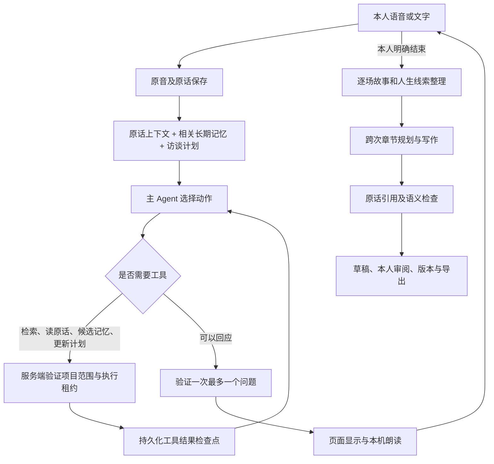

# 口述史 Agent 实现说明

> 最终产出已升级为持续写作的人生传记，当前书稿流程、文风约定、接口增量和迁移规则见 [人生传记](BIOGRAPHY.md)。下文 Agent、资料隔离和来源校验仍适用。

本轮在既有 FastAPI、SQLite、Worker、React 对谈页面上增量实现。旧 `/api/memoir` 私密时叙录的身份、数据表和文件空间保持独立。

## 工作流程

Agent 动作为追问、澄清、承接历史、换题、回顾与建议休息。暂停、结束、音频采集和上传仍由用户及确定性程序控制。Agent 不能自动结束场次、将候选线索确认为事实或写入旧时叙录。

## 主要模块

| 路径 | 职责 |
| --- | --- |
| `backend/agents/memoir_agent.py` | 有次数预算的工具循环、检查点和最终回应 |
| `backend/agents/model.py` | Kimi 工具调用、工具结果回传适配 |
| `backend/agents/state.py` | 决策与访谈计划结构校验 |
| `backend/agents/context.py` | 按预算装配本人原话、相关历史与较早原稿清单 |
| `backend/agents/tools.py` | 白名单工具、服务端固定项目作用域 |
| `backend/memory/repository.py` | 记忆、确认状态、更正及版本保存 |
| `backend/memory/retrieval.py` | 中文短语和二元词相关性检索 |
| `backend/memoir_editor/chapters.py` | 跨场次章节规划、写作、检查与阶段缓存 |
| `backend/memoir_editor/validation.py` | 连续原话校验及引用覆盖清单 |
| `frontend/src/MemoirNotebook.tsx` | 章节编辑、线索确认、更正、版本和导出 |

## Agent 与预算

- 普通回应可以只用一次模型调用；最多4次模型调用、3轮工具执行、6个工具。最后一次调用只提供 `respond`。超出预算时用简短承接结束本轮，不继续内部循环。
- 模型适配支持标准 `tool_calls` / `tool_call_id` / `role=tool` 回传。工具请求和内部文本不进入页面或朗读流，最终自然回应验证通过后才发送。
- 初始材料按约20,000字符装配，工具结果继续受到上下文预算约束。最新本人轮次完整保留；较早原稿可检索，读取长原稿支持 `start/max_chars`，截取结果明确标记。
- 计划持久化当前主题、已讲清的话题、未展开线索和明确跳过的话题。它是对谈方向，不是强制填满的人生提纲。
- 每批工具副作用与检查点同事务提交。进程正常中断归还租约后，重新领取同任务可接着工具结果执行。用户重试失败回复时产生新任务；候选记忆和 Agent 触发的书稿请求仍有幂等保护。
- 运行表保存结构化决策、工具结果和耗时，不保存模型内部推理，也不向浏览器暴露工具参数。

## 回复失败与恢复

本次修复对应“原话已保存，但没有得到回应”的路径，详情见 [回复恢复说明](REPLY_RECOVERY.md)。辅助记忆校验失败后，本轮暂缓其余工具，优先回应本人；不会放宽连续原话和时间依据校验。模型输出格式异常仅修复一次，仍未成功时明确标注为简短系统接续。

Kimi K3 的完整助手消息（含 `reasoning_content`）只在当前运行内存中回传；持久检查点仍不保存推理。进程恢复时把已完成工具结果作为资料提供，避免提交残缺的助手工具历史或重复副作用。临时网络错误由同一任务自动重试一次；鉴权、配置及内部错误直接提示。界面会显示恢复状态，成功后按原来的自动对谈状态接续收音；本人已经暂停时不会自动开麦。

## 长期记忆与更正

记忆由 Agent 按需记录，场次归档后也将带依据的人生事件写入记忆。搜索同时检索原始本人轮次，因而未被索引成结构化记忆的原文仍可找回。

每条记忆包含类型、标题、描述、原话中的时间、原话引用、状态、关联线索、备注和版本。模型只能产生 `candidate` 或 `uncertain`，确认由独立的人工作用端点执行。

状态包括：候选、存疑、本人已确认、本人提出异议、已有更正、不采用。相同标题的事件只建立关联；年份冲突保留，不静默合并。确认新线索时可明确选择替代旧线索，旧条目标为 `superseded` 并保留版本。

引用必须来自当前项目、`kind=memoir`、`role=human` 且非控制指令的连续原文。被更正的原话仍留存，但检索结果带有更正/异议状态，不作为新的确定结论。本人确认不等同于外部事实核验。

## 跨次章节与人工版本

1. 汇集项目内多场本人讲述；助手回应不作为经历来源。
2. 按新增场景增量维护稳定目录，允许跨章关联，同一人物的后来补充进入相关章节；先样章，认可写法后继续成书。
3. 分块写作，每段验证原话引用；额外做语义检查，明确问题最多修复一次。
4. 输出未被引用的轮次清单，供人工核对遗漏。引用存在不保证语义或事实真实。
5. 提交前检查任务租约、项目是否存在、输入指纹和当前书稿版本，迟到结果不能覆盖新原文或人工改稿。
6. 已审阅或人工编辑的版本继续保留；新生成结果作为 `pending_draft`，本人可先预览再决定采用。采用和每次编辑均保存旧版本。

场景、目录与通过检查的写作块会持久缓存。局部来源或文风变化只使相关章节需要续写；模型请求分批控制预算，失败保留已有书稿。章节定稿与人工改稿的新修订需明确采用。

新原话或记忆状态变化会将旧书稿标记为待更新。一次故事审阅、单条线索确认和整份书稿审阅是三个不同动作。

## 接口

均在 `/api/platform/projects/{pid}` 范围：

| 接口 | 用途 |
| --- | --- |
| `GET /conversation-archive` | 原场次、记忆列表、书稿和任务状态 |
| `POST /conversation-memories/{mid}/review` | 确认、异议、不采用；可指定被替代线索 |
| `GET /conversation-book` | 章节书稿、过期标记及任务状态 |
| `POST /conversation-book` | 创建或复用正在执行的章节任务 |
| `POST /conversation-book/review` | 编辑段落、审阅、采用新草稿 |
| `GET /conversation-book/versions` | 最近20个历史书稿版本 |

写入审阅接口都检查 `revision`。重复提交章节任务时复用活动任务。项目删除取消对谈、逐场整理及章节任务，并清理新增的记忆、计划、运行检查点、书稿及阶段缓存；原始资料沿用既有保留方式，不自动删除。

## 身份和运行方式

- `FANGTAN_AUTH_ENABLED=false` 仍为本机单人工作区，并不是多租户隔离。
- 认证开启时，新平台项目归属当前员工，列表、读取、写入、删除及对谈/记忆/书稿接口校验所有者；本地所有者 `-1` 的旧项目不会自动归给任意登录员工。
- 工具的项目编号由服务端绑定，模型参数不能改变资料范围。
- 默认通用 Worker 仍兼容所有任务。已有独立 `conversation_worker.py` 时，可给通用 Worker 添加 `--exclude-kind conversation_reply`，使即时回复由专用进程领取，避免被长篇整理占用。这里只提供参数，不会自行启动进程。
- 需要具备工具调用能力的已配置 Kimi 模型。沿用现有 API/转写配置；没有新增向量数据库、Redis、Agent 框架或云服务依赖。
- 自动逐场归档后会排入跨次章节任务；相较旧版可能增加模型调用。原有录音及云处理同意界面继续保留。

## 离线验证

后端按 `CONTRIBUTING.md` 设置独立临时目录、关闭认证并清空密钥后运行 `python -m unittest discover -s backend/tests -q`。新增 `test_memoir_agent.py` 覆盖工具循环、作用域、原话校验、记忆确认、更正、检查点恢复、版本保留及迟到结果。

前端先执行 `npm --prefix frontend ci`、`npm run build:platform`。然后运行 `node scripts/test-memoir-agent-ui.cjs`：全部构建资源与 API 请求由 Playwright 路由拦截，使用合成人物，检查章节编辑、引用、线索确认、采用新草稿、导出与桌面/手机布局。此脚本不启动 HTTP、API 或 Worker 服务。

云端工具选择质量、真实讲述的追问效果与实际费用需要另外进行有授权的真实模型验收；离线夹具通过不能证明这些质量指标已经改善。
