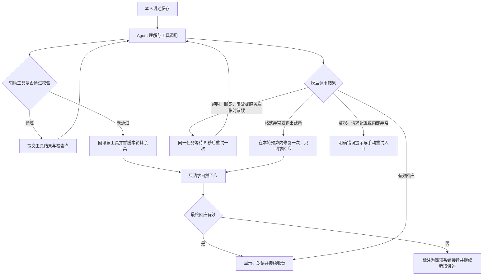

# 对谈回复失败的修复与验证

## 问题与修复范围

排查发现原话已经入库，相关进程也正常运行。离线重放确认候选记忆会因“时间没有原话依据”或“引用不是连续原话”被拒绝；原实现缺少明确恢复指引，同时把最终失败统一包装为“请重试”，无法判断后续在哪一步中断。模型适配还丢弃了 Kimi K3 工具循环所需的 `reasoning_content`。历史日志没有保留最终错误类型，因此不能把某次未回复断言为唯一一个原因。

修复不更改现有原话、录音、记忆确认与书稿审阅状态。

## 恢复路径

暂停、结束与设备错误仍优先于自动接续。重试耗尽后停止自动轮转，显示错误；重试不会重新提交本人原话。系统接续明确说明未生成完整 AI 回复，不冒充成功生成的内容。

## 实现约束

- `agents/tools.py` 向模型提供嵌套的候选记忆和引用结构。引用仍必须是本项目本人的连续原话，时间必须逐字出现在该引用中，没有明确时间使用“未提及”。模型只能提交候选或存疑状态。
- 单个工具失败时通过保存点回滚，不留下部分写入。给模型返回固定的错误码与纠正说明；同批后续工具也暂缓，每个工具调用仍配对返回结果。
- `agents/model.py` 按 Kimi K3 要求回传完整助手消息。K3 使用低推理预算与 `max_completion_tokens=4096`；预算包含推理与最终输出，不代表每次都会消耗全部额度。最终轮仅暴露并强制调用 `respond`。
- `reasoning_content` 仅驻留在当前工具循环内存中，不写数据库、前端或日志。恢复 K3 检查点时将已完成的工具结果作为用户资料续接，不伪造缺失的推理历史。工具副作用与检查点仍同事务提交。
- 单次运行最多 4 次模型请求、3 轮辅助工具、6 个工具。格式与正文校验异常合计最多修复一次，计入 4 次上限；未形成有效回应时使用已标注的系统接续。可选访谈计划无效不会丢掉有效回应正文。
- 新回复任务最多执行 2 次：初次执行加一次临时故障恢复。仅超时、连接中断、HTTP 408/429/5xx 自动恢复；鉴权、请求被拒绝和未知内部错误不自动重试。之前已经失败的任务不被自动重放，页面可手动重试。
- 错误分类覆盖 `model_timeout`、`model_network`、`model_busy`、`model_auth`、`model_request`、`model_incomplete`、`model_response`、`reply_invalid`、`agent_internal`。浏览器只收到固定提示，不回显提供商错误体、密钥或原话。
- `memoir_agent_diagnostics` 只保存任务、项目、固定错误码、阶段与时间，帮助区分记忆校验、模型格式与最终回应失败。项目删除同时清理这些诊断。

## 验证与生效

`backend/tests/test_agent_recovery.py` 覆盖连续原话与时间拒绝、失败后的回应、同批工具暂缓、模型消息回传、推理不落盘、格式修复预算、系统接续标记、无效计划、同任务恢复、重试耗尽、鉴权失败、检查点恢复与诊断清理。

`scripts/test-auto-conversation.cjs` 使用合成 API 与声音验证自动重试期间不重复提交、成功后继续收音、耗尽后的手动恢复、系统接续提示，以及重试中暂停后迟到回应不再开麦。保留原有十轮连续对谈与实际本地 Silero/AudioWorklet 回归。`scripts/test-memoir-agent-ui.cjs` 验证传记功能未被破坏。

2026-10-17 验证结果：后端完整 334 项测试通过，前端类型检查与生产构建通过，自动对谈 12 组浏览器回归及传记页面回归通过。全部使用隔离数据、合成声音与模拟云响应，没有额外调用真实 AI。

这些验证不证明真实模型的追问质量或网络可用性。代码生效需要重启 API、通用 Worker 与即时对谈 Worker，必须遵循用户明确授权后才能启停服务。本次已获得“现在重启三个进程”的明确授权，并在确认无活动任务后完成重启：三个进程正常，本机页面与 API 返回 200，页面引用最新构建资源，新增诊断表已初始化，启动日志无错误。

Kimi K3 消息回传要求参考 [官方模型说明](https://huggingface.co/moonshotai/Kimi-K3/blob/main/README.md)。
